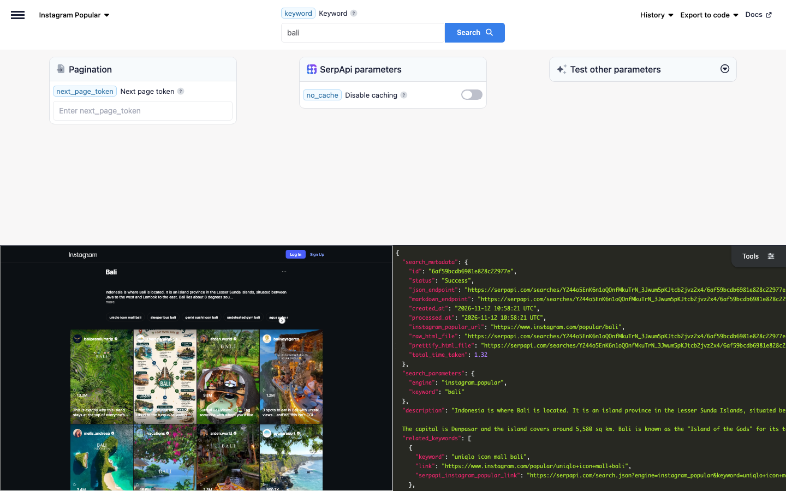

# Instagram Popular Scraper

Scrape Instagram's popular posts with SerpApi's Instagram Popular API. Search a keyword, like on Instagram's popular pages at `instagram.com/popular/<keyword>`, and get its top posts with each post's ID, shortcode, link, cover image, caption, play count, and video file, plus the account that posted it, with its username, verified badge, and profile picture. You also get Instagram's description of the keyword and related keywords, or, for some broad categories, popular keywords with their posts.

## How to scrape Instagram popular posts

Search Instagram's popular posts with a simple GET request:

```text
https://serpapi.com/search?engine=instagram_popular&keyword=bali&api_key=SERPAPI_API_KEY
```

- `keyword` is the keyword to find popular posts for, like the keyword of an Instagram popular page, e.g., `bali` for `instagram.com/popular/bali`. Keywords with several words or in other languages work too, e.g., `iced latte recipe` or `кофе`. Leave out the `#`: `#coffee` returns no posts, while `coffee` does.
- `api_key` is your SerpApi API key. Replace `SERPAPI_API_KEY` with it.
- `next_page_token` gets the next page of posts. Set it to `serpapi_pagination.next_page_token` from the previous page, and keep the same `keyword`. The first page has 12 posts, and the next pages have 8.

Instagram doesn't show popular posts for every keyword. For some, including common ones such as `paris`, `nike`, and `fitness`, the response has no posts and the error "Instagram Popular hasn't returned any results for this query." For some broad keywords, e.g., `basketball`, `golf`, or `tech`, Instagram returns a Category Hub page instead, with popular keywords in the category and their posts in `popular_keywords`. The same keyword can return a Category Hub page on one request and popular posts on the next, e.g., `football` and `basketball`.

[Register at SerpApi](https://serpapi.com?utm_source=github_instagram_popular_scraper) to get your API key, and keep it private.

### Playground

Try the request live in the [SerpApi Playground](https://serpapi.com/playground?engine=instagram_popular&keyword=bali&utm_source=github_instagram_popular_scraper).

[](https://serpapi.com/playground?engine=instagram_popular&keyword=bali&utm_source=github_instagram_popular_scraper)

## Code examples

The code examples read your API key from the `SERPAPI_API_KEY` environment variable:

```bash
export SERPAPI_API_KEY="SERPAPI_API_KEY"
```

Each example searches Instagram's popular posts for bali and prints the link, play count, and username of each post.

### curl integration

Send the request with curl, which prints the full JSON response:

```bash
curl --get https://serpapi.com/search \
 --data-urlencode engine="instagram_popular" \
 --data-urlencode keyword="bali" \
 --data-urlencode api_key="$SERPAPI_API_KEY"
```

### JavaScript integration

Install the [SerpApi JavaScript library](https://github.com/serpapi/serpapi-javascript) and set your project to use ES modules:

```bash
npm install serpapi
npm pkg set type=module
```

Create an `index.js` file:

```javascript
import { getJson } from "serpapi";

const results = await getJson({
  engine: "instagram_popular",
  api_key: process.env.SERPAPI_API_KEY,
  keyword: "bali",
});

for (const post of results.popular_results ?? []) {
  console.log(post.link, post.play_count, post.user?.username);
}
```

Run it with `node index.js`.

### Python integration

Install the [SerpApi Python library](https://github.com/serpapi/serpapi-python):

```bash
pip install serpapi
```

Create a `main.py` file:

```python
import os
import serpapi

client = serpapi.Client(api_key=os.getenv("SERPAPI_API_KEY"))
results = client.search({
    "engine": "instagram_popular",
    "keyword": "bali",
})

for post in results.get("popular_results", []):
    print(post["link"], post.get("play_count"), post.get("user", {}).get("username"))
```

Run it with `python main.py`.

### Ruby integration

Install the [SerpApi Ruby library](https://github.com/serpapi/serpapi-ruby):

```bash
gem install serpapi
```

Create a `main.rb` file:

```ruby
require "serpapi"

client = SerpApi::Client.new(engine: "instagram_popular", api_key: ENV.fetch("SERPAPI_API_KEY"))
results = client.search(keyword: "bali")

results.fetch(:popular_results, []).each do |post|
  puts "#{post[:link]} #{post[:play_count]} #{post.dig(:user, :username)}"
end

client.close
```

Run it with `ruby main.rb`.

### PHP integration

Install the [SerpApi PHP library](https://github.com/serpapi/serpapi-php):

```bash
composer require serpapi/serpapi-php
```

Create an `index.php` file:

```php
<?php
require 'vendor/autoload.php';

use SerpApi\Client;

$client = new Client(getenv('SERPAPI_API_KEY'), 'instagram_popular');
$results = $client->search([
  'keyword' => 'bali',
]);

foreach ($results->popular_results ?? [] as $post) {
  echo $post->link . ' ' . ($post->play_count ?? '') . ' ' . ($post->user->username ?? '') . PHP_EOL;
}
```

Run it with `php index.php`.

### Go integration

Create a Go module and install the [SerpApi Go library](https://github.com/serpapi/serpapi-golang):

```bash
go mod init example.com/instagram-popular
go get github.com/serpapi/serpapi-golang
```

Create a `main.go` file:

```go
package main

import (
	"fmt"
	"os"

	"github.com/serpapi/serpapi-golang"
)

func main() {
	setting := serpapi.NewSerpApiClientSetting(os.Getenv("SERPAPI_API_KEY"))
	setting.Engine = "instagram_popular"
	client := serpapi.NewClient(setting)

	results, err := client.Search(map[string]string{
		"keyword": "bali",
	})
	if err != nil {
		panic(err)
	}

	popularResults, _ := results["popular_results"].([]interface{})
	for _, item := range popularResults {
		post := item.(map[string]interface{})
		playCount, _ := post["play_count"].(float64)
		user, _ := post["user"].(map[string]interface{})
		fmt.Println(post["link"], int64(playCount), user["username"])
	}
}
```

Run it with `go run .`.

### Rust integration

Create a Cargo project and add the [SerpApi Rust library](https://github.com/serpapi/serpapi-rust) and Tokio:

```bash
cargo new instagram-popular && cd instagram-popular
cargo add serpapi tokio --features tokio/full
```

Replace `src/main.rs` with:

```rust
use serpapi::serpapi::Client;
use std::collections::HashMap;
use std::env;

#[tokio::main]
async fn main() -> Result<(), Box<dyn std::error::Error>> {
    let mut default = HashMap::new();
    default.insert("api_key".to_string(), env::var("SERPAPI_API_KEY")?);
    default.insert("engine".to_string(), "instagram_popular".to_string());
    let client = Client::new(default)?;

    let mut parameter = HashMap::new();
    parameter.insert("keyword".to_string(), "bali".to_string());

    let results = client.search(parameter).await?;
    if let Some(popular_results) = results["popular_results"].as_array() {
        for post in popular_results {
            println!(
                "{} {} {}",
                post["link"].as_str().unwrap_or_default(),
                post["play_count"],
                post["user"]["username"].as_str().unwrap_or_default()
            );
        }
    }
    Ok(())
}
```

Run it with `cargo run`.

### Other programming languages

Official libraries are also available for [Java](https://github.com/serpapi/serpapi-java), [.NET](https://github.com/serpapi/serpapi-dotnet), [Swift](https://github.com/serpapi/serpapi-swift), and [C++](https://github.com/serpapi/serpapi-cpp). See [SerpApi integrations](https://serpapi.com/integrations?utm_source=github_instagram_popular_scraper) for setup guides, or use a simple GET request from any programming language.

### Errors

Failed requests return an HTTP error status and a JSON body with an `error` message. The most common are `401` for an invalid API key, `400` for a missing required parameter such as `keyword` or for a `next_page_token` used with another keyword, and `429` when you exceed your hourly throughput limit or run out of searches. See [API status and error codes](https://serpapi.com/api-status-and-error-codes?utm_source=github_instagram_popular_scraper) for the full list.

A search without posts, e.g., for `paris`, `#coffee`, or a made-up word, still returns `200`, with `search_metadata.status` set to `Success`, `search_information.popular_results_state` set to `Fully empty`, and an `error` message, so check for `error` before reading `popular_results`. A Category Hub page has no `popular_results` either, but has `popular_keywords` instead.

## Output formats: JSON and Markdown

Choose structured JSON for applications or Markdown for LLMs and AI agents:

- JSON is the default output and is useful when you need individual result fields.
- Add `output=md` to receive Markdown instead, which is more token-efficient.

Markdown is plain text, not JSON: YAML front matter with the search metadata, followed by Instagram's description of the keyword, a table of the related keywords, a table of the posts with their image links, captions linked to the posts, account fields, play counts, and video links, and a link to the next page. On a Category Hub page, the table of popular keywords leaves out their posts, which are only in the JSON response. Read the response body as text instead of parsing it.

| Client | Markdown request |
|--------|------------------|
| curl | `--data-urlencode output="md"` |
| Python | `client.search({..., "output": "md"})` |
| PHP | `$client->md([...])` |
| Go | `client.Md(map[string]string{...})` |
| Rust | `client.md(parameter).await?` |

If your SDK doesn't have a Markdown helper yet, send a plain HTTP request with `output=md` and read the body as text. Learn more about [Markdown output](https://serpapi.com/markdown-output?utm_source=github_instagram_popular_scraper).

## Instagram Popular API parameters

See the [Instagram Popular API documentation](https://serpapi.com/instagram-popular-api?utm_source=github_instagram_popular_scraper) for more details.

| Name | Description | Requirement |
|------|-------------|-------------|
| **Search query** | | |
| `keyword` | The keyword to find popular posts for, like the keyword of an Instagram popular page at `instagram.com/popular/<keyword>` (e.g., `bali` or `iced latte recipe`). Keywords in other languages work (e.g., `кофе`), but hashtags don't: `#coffee` returns no posts. | Required |
| **Pagination** | | |
| `next_page_token` | The token for the next page of posts, from `serpapi_pagination.next_page_token` of the previous page. Use it with the same `keyword` you used to get it; with another keyword, it returns a `400` error. The first page has 12 posts, and the next pages have 8. The last page and Category Hub pages have no `serpapi_pagination`. | Optional |
| **SerpApi parameters** | | |
| `engine` | Set to `instagram_popular`. | Required |
| `api_key` | Your private SerpApi API key. | Required |
| `no_cache` | Set to `true` to request fresh results instead of using the one-hour cache. Can't be combined with `async`. | Optional |
| `async` | Set to `true` for later retrieval through the [Searches Archive API](https://serpapi.com/search-archive-api?utm_source=github_instagram_popular_scraper). Can't be combined with `no_cache` or used with Ludicrous Speed enabled. | Optional |
| `zero_trace` | Enterprise only. Set to `true` to skip storing search parameters, files, and metadata on SerpApi servers. | Optional |
| `output` | Set to `json` (default), `html` for the raw HTML retrieved from Instagram, or `md` for Markdown. | Optional |
| `json_restrictor` | Limit the JSON response to the fields you need. See the [JSON Restrictor](https://serpapi.com/json-restrictor?utm_source=github_instagram_popular_scraper) documentation. | Optional |

## Available data on Instagram popular posts (JSON response)

Each item in `popular_results` is a popular post for `keyword`, with the account that posted it in `user`. The first page also has Instagram's `description` of the keyword and `related_keywords` to explore. For some broad keywords, Instagram returns a Category Hub page instead, with `popular_keywords` and their posts. The field guides below describe the possible fields and their types; they aren't literal API responses.

### What you get depends on the keyword and the page

Some fields appear only on some pages:

| Keyword or page | Fields |
|-----------------|--------|
| A keyword with popular posts, e.g., bali | `description`, up to 10 `related_keywords`, e.g., is bali safe, 12 `popular_results`, and `serpapi_pagination` |
| Some keywords, e.g., coffee or matcha latte | An empty `related_keywords` list |
| A post without a caption | No `caption` |
| The next pages | Only `popular_results`, with 8 posts, and `serpapi_pagination` |
| The last page | No `serpapi_pagination`, e.g., page 5 of andronis arcadia santorini, with 4 posts |
| A broad keyword on a Category Hub page, e.g., basketball, golf, or tech | `description`, 5 `popular_keywords`, e.g., the tallest basketball player, with 32 to 60 posts each, and 20 categories in `related_keywords`, with a `display_name`, e.g., Motorsports and Cycling, and a thumbnail. No `popular_results` or `serpapi_pagination` |
| A keyword without popular posts, e.g., paris | Only `search_information` and `error` |

Each post has an `id`, which is `POLARIS_` followed by Instagram's media ID, e.g., `POLARIS_2918332871356056719`, a `shortcode`, e.g., `CiAAEjVhgSP`, and a `link` to the post, e.g., `https://www.instagram.com/reel/CiAAEjVhgSP` for a post by ayanaresort. All posts seen live are reels, even for keywords such as `landscape photography`, `quotes`, or `infographic`, so each post in `popular_results` has a `play_count` and a link to the video file. The response has no like or comment counts and no post dates.

The image and video links on Instagram's CDN are signed and expire: the images after about 4 days, and the videos after 1 to 4 days. The `serpapi_` links load the same images through SerpApi, but they don't last forever either, so save the images and videos you need.

To get the next page, pass `serpapi_pagination.next_page_token` as `next_page_token` with the same `keyword`, or follow `serpapi_pagination.next`. To search a related or popular keyword, follow its `serpapi_instagram_popular_link`. To get the profile of the account behind a post with the [Instagram Profile API](https://serpapi.com/instagram-profile-api?utm_source=github_instagram_popular_scraper), follow `user.serpapi_instagram_profile_link`.

### Popular results

Each post in `popular_results` can include these fields:

```json
{
  "popular_results": [
    {
      "id": "String - POLARIS_ followed by the Instagram media ID of the post, e.g., POLARIS_2918332871356056719",
      "position": "Integer - Position of the post, starting at 1 on each page",
      "shortcode": "String - Shortcode of the post, used in its link, e.g., CiAAEjVhgSP",
      "link": "String - Link to the post on Instagram, e.g., https://www.instagram.com/reel/CiAAEjVhgSP",
      "display_url": "String - Link to the cover image of the post on Instagram's CDN, at most 640 pixels on each side, e.g., 360 by 640",
      "serpapi_display_url": "String - Link to the cover image through SerpApi",
      "caption": "String - Caption of the post, with its hashtags and mentions",
      "user": {
        "id": "String - Instagram ID of the account, e.g., 17841400599947284",
        "is_verified": "Boolean - true if the account has a verified badge",
        "profile_pic_url": "String - Link to the profile picture on Instagram's CDN",
        "serpapi_profile_pic_url": "String - Link to the profile picture through SerpApi",
        "username": "String - Username of the account, e.g., ayanaresort",
        "link": "String - Link to the account on Instagram, e.g., https://www.instagram.com/ayanaresort",
        "serpapi_instagram_profile_link": "String - SerpApi link to the profile of the account with the Instagram Profile API, with the username as profile_id"
      },
      "play_count": "Integer - Number of plays of the reel, e.g., 900708",
      "video_versions": "Array[String] - Link to the MP4 video file on Instagram's CDN"
    }
  ]
}
```

`video_versions` has a single link. `user.id` isn't the ID the Instagram Profile API returns for the same account in `profile_results.id`, e.g., 466195998 for ayanaresort, so match accounts across both APIs by `username`.

### Category Hub

Each keyword in `popular_keywords` can include these fields:

```json
{
  "popular_keywords": [
    {
      "keyword": "String - Popular keyword in the category, e.g., the tallest basketball player",
      "link": "String - Link to the Instagram popular page of the keyword, e.g., https://www.instagram.com/popular/the-tallest-basketball-player/",
      "serpapi_instagram_popular_link": "String - SerpApi link to the popular posts for the keyword",
      "popular_results": [
        {
          "id": "String - POLARIS_ followed by the Instagram media ID of the post",
          "position": "Integer - Position of the post within the keyword",
          "shortcode": "String - Shortcode of the post, used in its link",
          "link": "String - Link to the post on Instagram",
          "display_url": "String - Link to the cover image of the post on Instagram's CDN",
          "serpapi_display_url": "String - Link to the cover image through SerpApi",
          "user": {
            "id": "String - Instagram ID of the account"
          },
          "play_count": "Integer - Number of plays of the reel"
        }
      ]
    }
  ]
}
```

The posts of a Category Hub page have no caption, username, verified badge, or video link. To get them, follow the keyword's `serpapi_instagram_popular_link`. A few posts have no `display_url` or `play_count`.

### Related keywords

Each keyword in `related_keywords` can include these fields:

```json
{
  "related_keywords": [
    {
      "display_name": "String - Name of the category, on Category Hub pages, e.g., Motorsports and Cycling",
      "keyword": "String - Related keyword, e.g., is bali safe, or the keyword of the category, e.g., cycling",
      "link": "String - Link to the Instagram popular page of the keyword, e.g., https://www.instagram.com/popular/is+bali+safe",
      "serpapi_instagram_popular_link": "String - SerpApi link to the popular posts for the keyword",
      "thumbnail_url": "String - Link to the thumbnail of the category on Instagram's CDN, on Category Hub pages",
      "serpapi_thumbnail_url": "String - Link to the thumbnail of the category through SerpApi, on Category Hub pages"
    }
  ]
}
```

A Category Hub page lists 20 categories, e.g., Martial Arts, Golf, or Tech and Electronics. Searching the keyword of a category doesn't always return a Category Hub page: `cycling`, `interior design`, and `recipes and cooking` returned popular posts.

### Description, search information, and pagination

`description` summarizes the keyword, `search_information` is only present when the search has no posts, and `serpapi_pagination` links to the next page:

```json
{
  "description": "String - Instagram's summary of the keyword, in 2 or 3 paragraphs with footnote markers, e.g., Indonesia is where Bali is located. It is an island province in the Lesser Sunda Islands, ...",
  "search_information": {
    "popular_results_state": "String - Fully empty when the search has no posts"
  },
  "serpapi_pagination": {
    "next_page_token": "String - Token for the next page, for the next_page_token parameter",
    "next": "String - SerpApi link to the next page"
  }
}
```

`description` is usually in English, but its language doesn't follow the keyword: `football` returned a description in Portuguese, `santorini` in Spanish, and `кофе` in English. For some keywords, it describes a matching account instead, e.g., LEGO (lego) for `lego`. The sources of the footnote markers, e.g., ¹ ², aren't in the response.

## AI agents and no-code

### MCP

Give AI agents and assistants an Instagram popular posts search tool with the hosted [SerpApi MCP server](https://github.com/serpapi/serpapi-mcp) at `https://mcp.serpapi.com/mcp`.

Claude Code:

```bash
claude mcp add --transport http serpapi https://mcp.serpapi.com/mcp --header "Authorization: Bearer $SERPAPI_API_KEY"
```

Codex, which reads the key from `SERPAPI_API_KEY`:

```bash
codex mcp add serpapi --url https://mcp.serpapi.com/mcp --bearer-token-env-var SERPAPI_API_KEY
```

Other MCP clients:

```json
{
  "mcpServers": {
    "serpapi": {
      "type": "http",
      "url": "https://mcp.serpapi.com/SERPAPI_API_KEY/mcp"
    }
  }
}
```

The server's engine catalog includes the `instagram_popular` engine, and its `serpapi://engines/instagram_popular` resource describes the parameters. Ask your agent to find popular Instagram posts for a keyword with the `instagram_popular` engine. The resulting tool call looks like this:

```json
{
  "name": "search",
  "arguments": {
    "params": {
      "engine": "instagram_popular",
      "keyword": "bali"
    }
  }
}
```

See the [MCP integration guide](https://serpapi.com/integrations/mcp?utm_source=github_instagram_popular_scraper) for more clients and self-hosting.

### CLI

Search Instagram's popular posts from your terminal or from AI agent workflows with the [SerpApi CLI](https://github.com/serpapi/serpapi-cli):

```bash
brew tap serpapi/homebrew-tap
brew install serpapi-cli
```

The CLI picks up `SERPAPI_API_KEY` from your environment. You can also run `serpapi login` to save a key.

```bash
serpapi search engine=instagram_popular keyword=bali
serpapi search engine=instagram_popular keyword=bali --fields "popular_results[].{link, play_count, caption}"
serpapi search engine=instagram_popular keyword=bali output=md
```

### No-code tools

Use SerpApi APIs without writing code:

- [NoCodeSerpApi](https://nocodeserpapi.com/)
- [SerpApi with n8n](https://serpapi.com/blog/tag/n8n/)
- [SerpApi with Make](https://serpapi.com/blog/tag/make/)
- [More integrations](https://github.com/serpapi/serpapi-integrations/)

## Use cases

- Find the reels that perform best for a keyword, with their play counts and captions, to plan content for a brand, product, or destination.
- Monitor whether your brand's reels and your competitors' reels appear among the popular posts for your product or travel keywords.
- Research influencer marketing by finding the brand and verified accounts behind popular posts in a niche, then getting their profiles with the Instagram Profile API.
- Discover trending subtopics and long-tail keywords with `related_keywords` and the `popular_keywords` of Category Hub pages.
- Track the hashtags and topics of popular posts over time for social listening and trend analysis.
- Give AI agents and RAG pipelines an Instagram trend research tool.

## Related scrapers

- [Instagram Profile Scraper](https://github.com/serpapi/instagram-profile-scraper): Instagram profiles and their recent posts
- [Facebook Profile Scraper](https://github.com/serpapi/facebook-profile-scraper): Facebook pages and profiles by username or ID
- [YouTube Scraper](https://github.com/serpapi/youtube-scraper): YouTube search results

## Contact

Feel free to reach out at [contact@serpapi.com](mailto:contact@serpapi.com).
